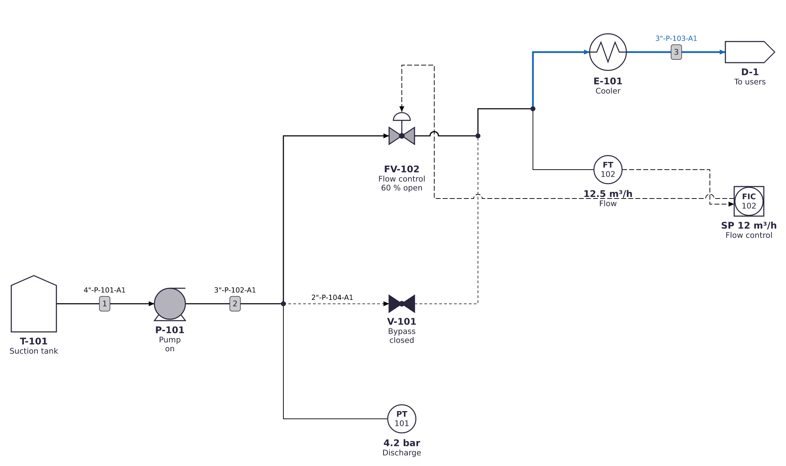
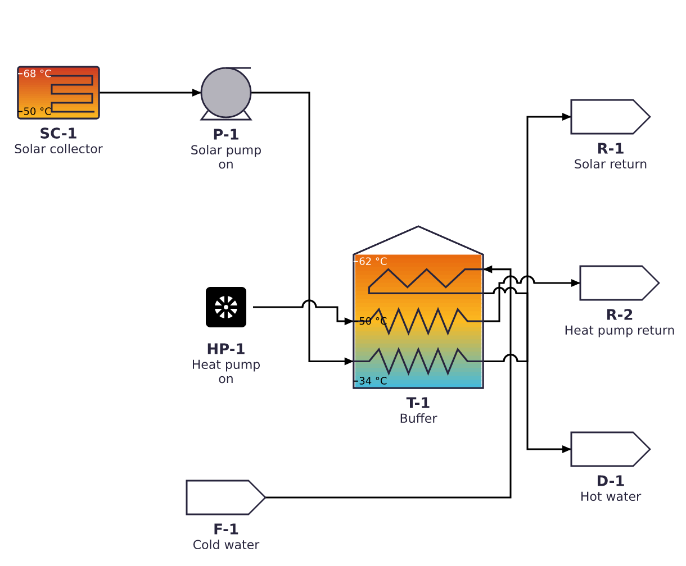
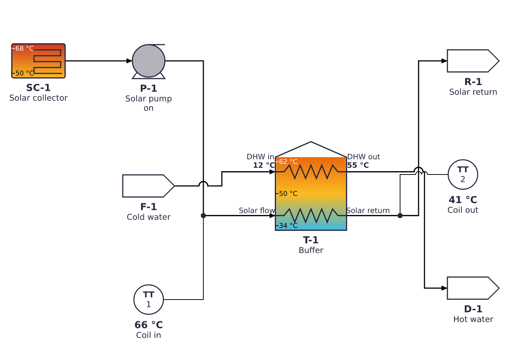
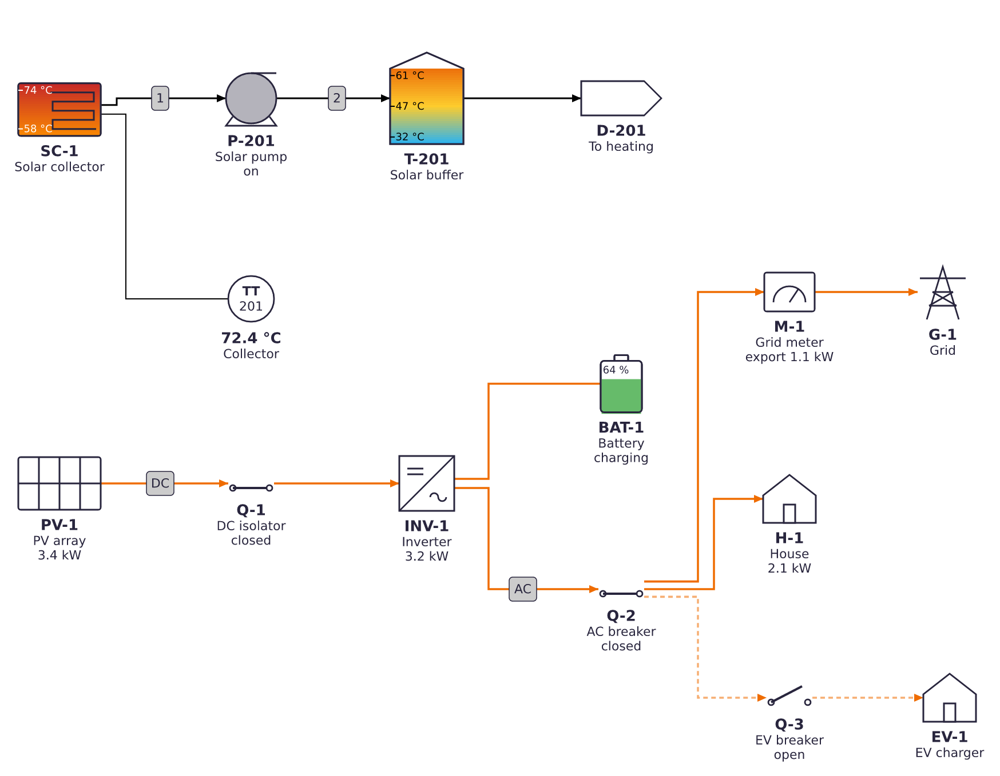
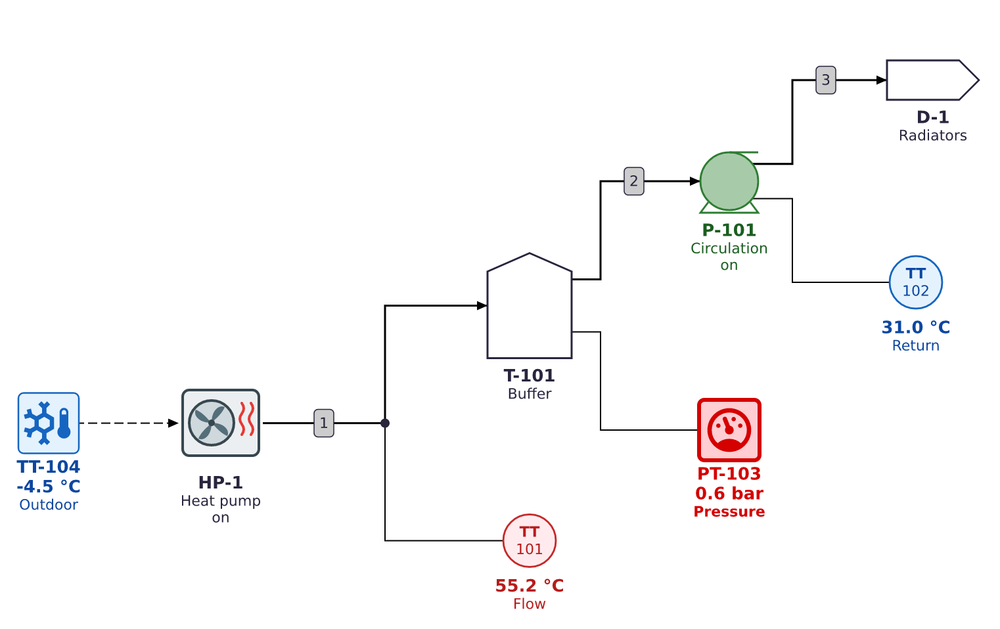
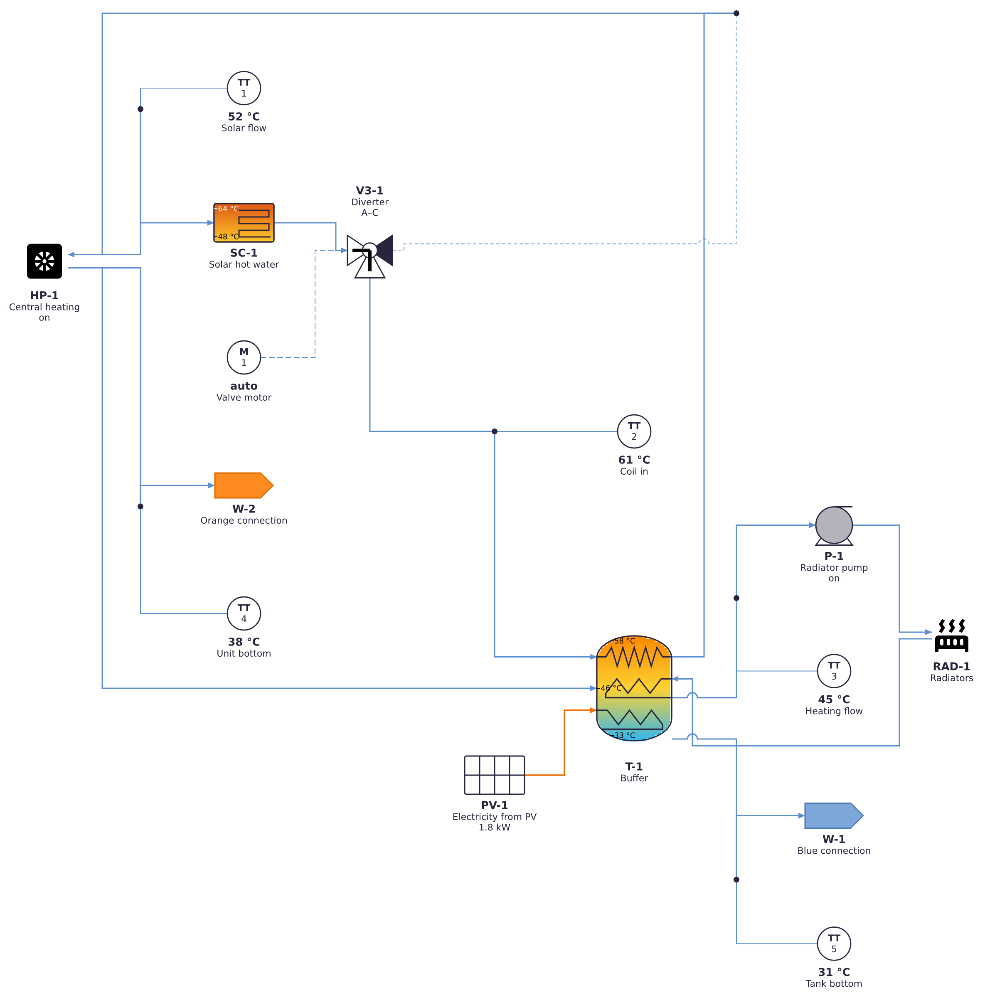

# pid

[-Default-41BDF5.svg)](https://hacs.xyz)
[](https://github.com/NdS-Research-Facilities/pid/actions/workflows/ci.yml)
[](https://github.com/NdS-Research-Facilities/pid/actions/workflows/marketplace.yml)

> [!IMPORTANT]
> **The Home Assistant card (`custom:pid-card`) draws P&ID diagrams only.** Its diagram text
> must start with `pid` (for example `pid LR`). Flowcharts, sequence diagrams, Gantt charts and
> every other Mermaid diagram type are **not included** in this card and show an error. Use a
> general Mermaid card, such as [ha-mermaid](https://github.com/pajew-ski/ha-mermaid), for those;
> both cards can be used on the same dashboard.

Declarative piping and instrumentation diagrams (P&IDs) for
[Mermaid v13](https://mermaid.js.org/intro/v13-alpha.html), with live values from Home Assistant.

`@nds/diagram-pid` is a Mermaid v13 diagram plugin. It reads `pid` text, lays it out with
Mermaid's own graph engine and draws equipment, valves, ISA-5.1 instruments, process lines and
signal lines. Equipment and instruments carry a state, so a Home Assistant card can fill in live
values through templates.

```
pid LR
  title Buffer tank temperature control
  S-1: feed "Steam"
  TV-101: valve "Steam valve" = 35%
  T-101: tank "Buffer"
  P-101: pump "Circulation" = on
  E-101: exchanger "Heater"
  D-1: product "To process"

  TT-101: instrument "Buffer temp" = 42.5 °C
  TIC-101: instrument dcs "Temp control" = SP 45 °C
  LT-102: instrument "Level" = 73 %

  S-1 --> TV-101 --> E-101
  T-101 -->|1| P-101 -->|2| E-101 -->|3| D-1
  T-101 --- TT-101
  T-101 --- LT-102
  TT-101 -.-> TIC-101 -.-> TV-101
```

## Everything at once

[`examples/all-capabilities.mmd`](examples/all-capabilities.mmd) is a small process plant that
uses every statement, equipment type, valve kind, 3-way bore, instrument location, state style
and line kind. [`examples/all-capabilities.card.yaml`](examples/all-capabilities.card.yaml) is
the same plant as a Home Assistant card: every value from an entity template, plus every card
option (actions, icon packs, image base, theme).


## Syntax

| Statement | Meaning |
| --- | --- |
| `pid [LR\|RL\|TB\|BT]` | Header and flow direction (default `LR`) |
| `title Text` | Diagram title |
| `TAG: type "Name" = state` | Equipment; name and state optional |
| `TAG: instrument [location] "Name" = value` | ISA-5.1 instrument; see below |
| `TAG: valve [kind] "Name" = state` | Valve; see below |
| `TAG = state` | Set a state on its own line (handy for templates) |
| `A --> B -->\|1\| C` | Process line; `\|1\|` is the stream tag |
| `A --- B` | Instrument connection to the process (thin line) |
| `A -.-> B`, `A -.- B` | Signal line (dashed), with or without arrow |
| `A ==> B`, `A === B` | Electrical power cable (orange), with or without arrow (direction of power) |
| `A f1@--> B` | A named line (any line kind), for `class`, `style`, `linkStyle`, `pipe` and `follow` |
| `follow r5 V-1.C` | Show named lines blocked whenever a valve port, valve, breaker or other line is |
| `nozzle TAG id side "Text"`, `TAG.id` | A named connection point on equipment, and a line to it |
| `coil TAG where … in "Text" out "Text"`, `TAG.coil1.in` | A coil in a vessel, its ends described, and a line to one end |
| `CV.n1 = 70 °C`, `TAG.coil1.in = 66 °C` | A reading at a nozzle or coil end, without an instrument |
| `stream 1 { T: 25 °C, F: 1200 kg/h }` | Property table shown with stream `1` |
| `%% comment` | Comment |

**Equipment types:** `block tank vessel drum column reactor pump compressor exchanger valve
valve3 feed product instrument tee`, and for solar and electrical installations `collector pv
inverter battery breaker meter grid consumer` (see below).

### Actuators

```
actuator V3-1 motor        %% a motor (M) on a 3-way valve
actuator MV-8 motor        %% …or on a 2-way valve
actuator FV-7 diaphragm    %% the control valve's dome (also what a signal line gives)
```

Valves and 3-way valves can carry an actuator: a `motor` (a circle with an M) or a `diaphragm`.
A valve a signal line drives gets a diaphragm unless `actuator` says otherwise, and the signal
lands on the actuator. On a 3-way valve the actuator sits opposite port C, and moves with it when
the valve is mirrored; the M always reads upright.

### Tees and crossings

A `tee` is a junction on a pipe, drawn as a connection dot. Lines split and join at it without
arrowheads, and instruments can tap the pipe there:

```
J-1: tee
P-101 --> J-1 --> FV-102
J-1 --> V-101 --> J-2
J-1 --- PT-101
```

Where two lines cross without a tee, one hops over the other with a small arc.

### Line numbers and line styles

```
pipe 1 4"-P-101-A1              %% by stream tag
pipe J-1>V-101 2"-P-104-A1      %% by its ends
linkStyle 5,6 stroke:#1565c0,stroke-width:2.5px
linkStyle default stroke-width:2px
```

`pipe` writes a line number along the pipe, above its stream tag; the layout keeps room for it.
`linkStyle` works as in Mermaid: lines are numbered from 0 in the order they are written, and
`default` applies to every line. A line the state shows as blocked stays dashed whatever its
style.

A line on a shut valve port is dashed by itself; `follow` dashes other named lines with it, such
as the rest of a circuit the valve cuts off:

```
V-1.C r3@--> T-1.coil1          %% dashed when V-1 shuts port C
T-1.coil1 r5@--> C-3
follow r5 V-1.C                 %% …and r5 with it
follow k1,k2 V-2                %% lines blocked while valve V-2 is closed (or a breaker open)
follow r4 r5                    %% blocked whenever line r5 is
```

It only shows a state, so it follows the valve's state as the card fills it in. Process lines and
cables show it; instrument and signal lines are never dashed.

Lines can also be named and styled by class, as in Mermaid flowcharts:

```
classDef flow   stroke:#ef6c00,stroke-width:2.5px
classDef return stroke:#5b8fd0
CV f1@--> T-1 f2@--> P-1 f3@--> VV-Keuken    %% name a line with ID@
VV-Keuken r1@--> T-2
class f1,f2,f3 flow                          %% the same class as for equipment
class r1 return
style f2 stroke-dasharray:4 2                %% one line's own style
linkStyle r1 stroke-width:3px                %% linkStyle and pipe take names too
```

A class that is not a plain name, such as a template not filled in outside Home Assistant, is
ignored, so a fixed class written before it stays in effect.

A line takes `linkStyle default` first, then its classes, then its own `style` / `linkStyle`;
blocking (a closed valve, an open breaker) still dashes it. Each class is also written as an SVG
class, `class-<name>`. In the card a class name can come from a template, so a whole circuit
changes with one line:

```
class f2,f3,r1 ${if(is_state('switch.keuken_cv_pomp_vv_lsc_plug_relay', 'on'), 'flow', 'off')}
```



### Instruments

The tag is drawn inside the bubble, ISA-5.1 style: function letters over the loop number
(`TIC-101` → `TIC` / `101`). The state is the reading, shown in bold under the bubble.
`unavailable` or `unknown` shows `?` and a dashed bubble.

| Location | Symbol |
| --- | --- |
| `field` (default) | circle |
| `panel` | circle with a line through it |
| `dcs` | circle in a square (shared display / control) |
| `plc` | diamond in a square |
| `computer` | hexagon |

### Valves

- `valve [kind]`: kinds `gate` (default), `globe`, `ball`, `plug`, `butterfly`, `check` and
  `relief` (angle valve with spring; its outlet leaves sideways, like a 3-way valve's `C`; being
  closed in normal service, it never dashes its lines).
  State `open`, `closed`, `opening`, `closing`, a position `0`–`100` (`%` optional), or
  `unavailable`. Closed is drawn solid, open hollow, partly open shaded; moving or unknown is
  dashed. A valve that a signal line drives (`TIC-101 -.-> TV-101`) is drawn as a control valve
  with an actuator, and the signal lands on the actuator.
- `valve3 [L|T]` (3-way): ports `A` (inlet), `B` (straight through) and `C` (branch). Lines
  attach to a port with `V-1.A`. The state lists the connected ports: `AB`, `AC`, `BC`, `ABC`,
  `open` (all) or `closed`. Shut ports are solid, and the process lines on them are dashed.
  - `L`: an L-port ball, joining C to A or to B (`AC`, `BC`) or `closed`.
  - `T`: a T-port ball, joining any two ports or all three (`AB`, `AC`, `BC`, `ABC`); it
    cannot shut off.
  - With `L` or `T` the ball is drawn with its bore pointing at the connected ports. A state
    the bore cannot make (an L-port at `ABC`, a T-port `closed`) is drawn dashed, with the
    reason under the valve, so a wrong sensor value or template stands out.
  - Without `L` or `T`, any combination is accepted and no bore is drawn.

  

### Coils inside vessels

Tanks, vessels, drums, columns and reactors can hold heat exchanger coils:

```
T-1: tank "Buffer"
coil T-1 bottom "Solar coil"            %% top | middle | bottom | @NN% (height from the bottom)
coil T-1 middle "Heat pump coil"
coil T-1 top right "Hot water coil"     %% left | right: both nozzles on that wall
coil T-1 @30% left right                %% inlet wall, then outlet wall: straight through
P-1 --> T-1.coil1                       %% into coil 1's inlet
T-1.coil1 --> R-1                       %% out of its outlet
PV-1 ==> T-1.coil3                      %% a cable: an electric heating element
```

- Coils are numbered in the order they are written: `coil1`, `coil2`, …; the name shows as a
  tooltip.
- Each nozzle goes on the wall facing its line, unless you name the walls: one word for both, or
  the inlet's then the outlet's. On opposite walls the coil runs straight through; on one wall it
  turns back, and the inlet takes the upper or lower nozzle, whichever its line comes from, so
  the two lines don't cross.
- Coils are drawn over a gradient or level, so the tank's temperatures still show.
- A vessel with coils is drawn larger so they stay readable (×1.25, ×1.5, ×1.8 for one, two,
  three or more).

`size TAG 1.5` draws any symbol larger or smaller (0.5 to 3); readings and line weights keep
their size.



[`examples/coils.mmd`](examples/coils.mmd) has this example.

#### Coil ends

Like a nozzle, each end of a coil can be described and reached by name, so an instrument (a
temperature probe on the flow and the return, say) goes on the end you mean, or its reading is
shown right there:

```
coil T-1 bottom "Solar coil" in "Solar flow" out "Solar return"
P-1 --> T-1.coil1                       %% the process lines, as before
T-1.coil1 --> R-1
TT-1 --- T-1.coil1.in                   %% on the inlet…
T-1.coil1.out --- TT-2                  %% …and on the outlet, whichever way the line is written

coil T-1 top "Hot water coil" in "DHW in" out "DHW out"
T-1.coil2.in = 12 °C                    %% or just the readings, without instruments
T-1.coil2.out = 55 °C
```

- `TAG.coil1.in` and `TAG.coil1.out` name an end; plain `TAG.coil1` still means the outlet for a
  line leaving it and the inlet for a line reaching it.
- What hangs on the inlet is placed before the vessel, and what hangs on the outlet after it.
- `in "Text"` and `out "Text"` are drawn in small text outside the wall, as nozzle descriptions.
- An instrument line joins the pipe where it meets it, at a junction dot, rather than running
  along it into the coil. The same goes for a second line on a named nozzle.
- A reading (`TAG.coil1.in = 66 °C`) is drawn in bold beside its end, between the line and the
  description, with `?` for `unavailable` or `unknown` as on an instrument. It takes no room in the
  layout, so it is the lighter choice on a busy diagram. Readings work on named nozzles too
  (`CV.n1 = 70 °C`), and an empty one (a template that chose nothing) shows nothing.



[`examples/coil-ends.mmd`](examples/coil-ends.mmd) has this example.

### Nozzles

Named connection points on any equipment (not tees and valves, which have their own), so the
lines of a busy piece of equipment are spread out, in an order you choose, and described:

```
nozzle CV n1 right "CH flow"            %% nozzle TAG id left|right|top|bottom ["Description"]
nozzle CV n2 right "CH return"
nozzle CV n4 left "DHW out"
nozzle CV n3 left "DHW in"
CV.n1 --> C-1                           %% a line from a nozzle…
C-3 --> CV.n2                           %% …or to one
```

- Nozzles on one side are spread evenly along it in the order written (top to bottom on the left
  and right, left to right on the top and bottom): reorder them to untangle lines.
- Each is drawn as a short stub with its description in small text (and as a tooltip); room is
  kept for them, so the equipment's own labels move clear.
- A symbol grows when a side has more nozzles than fit; an image or icon keeps its size and is
  drawn inside an outline that carries the nozzles.
- Lines without a nozzle attach as before.
- Several lines can share a nozzle (a pipe and the instrument on it): the first process line runs
  into it, and the others join that pipe at a junction dot.
- `CV.n1 = 70 °C` shows a reading at the nozzle, in bold between the line and its description;
  see [Coil ends](#coil-ends).

### Solar and electrical

| Type | Draws | State |
| --- | --- | --- |
| `collector` | solar thermal collector (water): a panel with its absorber pipe | any reading; takes a `gradient` |
| `pv` | photovoltaic panel or array: a grid of cells | any reading, e.g. `3.4 kW` |
| `inverter` | DC/AC inverter (IEC: diagonal, `=` and `~`) | any reading |
| `battery` | battery; `level` shows its state of charge (green) | any reading, e.g. `charging` |
| `breaker` | breaker or isolator; the blade is drawn closed or open | `closed`/`on` conducts, `open`/`off`/`tripped` isolates |
| `meter` | energy meter | any reading |
| `grid` | the utility grid (a pylon) | |
| `consumer` | the house or load the power goes to | any reading |

Power cables are `==>` (with the direction of power flow) and `===`, drawn as solid orange
lines; `linkStyle` recolours them. A breaker that is open dashes the cables on it, as a closed
valve does its pipes. Note the electrical sense: a **closed** breaker conducts.

```
PV-1: pv "PV array" = 3.4 kW
Q-1: breaker "DC isolator" = closed
INV-1: inverter "Inverter" = 3.2 kW
BAT-1: battery "Battery" = charging
level BAT-1 64 %
PV-1 ==>|DC| Q-1 ==> INV-1 ==>|AC| M-1 ==> G-1
INV-1 === BAT-1
```



[`examples/solar.mmd`](examples/solar.mmd) has the full example.

### Gradients and levels

Tanks, vessels, drums, columns, reactors, solar collectors and batteries can show their
contents:

```
gradient T-1 64 °C, 52 °C, 38 °C, 27 °C        %% readings, top to bottom
gradient T-2 61 °C @90%, 45 °C @50%, 30 °C @15% %% at sensor heights (from the bottom)
gradient T-3 #c62828, rgb(255, 193, 7), #1565c0 %% colours instead of readings
gradient-range 20 70                            %% the colour scale: cold … hot (default)
gradient-range T-8 35 60                        %% one vessel's own scale
level T-6 73 %                                  %% liquid level, filled from the bottom
level T-7 40 % #ffb74d                          %% with its own colour
gradient-marks off                              %% hide the readings
```

- A **reading** goes on the colour scale, blue (cold) through yellow to red (hot); stops
  without `@NN%` are spread evenly from top to bottom, and the colours blend between them.
  Readings and colours can be mixed. Stops are separated by commas, so readings use a decimal
  point.
- With a **level**, only the liquid is coloured; the surface gets a line and the P&ID ▽.
- Each reading is written at its height on the inside wall, in black or white for contrast; a
  reading or level Home Assistant does not have (`unavailable`) shows `?`.
- In the card the values come from templates, so the tank follows its sensors:

  ```
  gradient T-1 ${states['sensor.buffer_top']} °C, ${states['sensor.buffer_mid']} °C, ${states['sensor.buffer_bottom']} °C
  level T-1 ${states['sensor.buffer_level']}
  ```


[`examples/gradients.mmd`](examples/gradients.mmd) shows every option;
[`examples/gradients-no-marks.mmd`](examples/gradients-no-marks.mmd) the same without readings.

### Colours, icons and images

Mermaid's own styling statements work on equipment and instruments:

```
classDef alarm fill:#ffcdd2,stroke:#d50000,stroke-width:3px,color:#d50000,font-weight:bold
classDef ok fill:#e8f5e9,stroke:#2e7d32
class PT-103 alarm
class TT-101,TT-102 ok
style P-101 fill:#e8f5e9,stroke:#2e7d32
```

`fill` colours the symbol, `stroke` its outline (and a closed valve's solid fill), `color` the
labels; `stroke-width`, `stroke-dasharray`, `opacity`, `font-weight` and `font-style` apply too.
Mermaid checks every value and drops unsafe ones with a warning. Each class is also written as
an SVG class, `class-<name>`. In the card the class can come from a template, so colours follow
live values:

```
class TT-101 ${if(states['sensor.flow_temp'] > 60, 'alarm', 'ok')}
```

A picture can replace any symbol, keeping its tag, value and name labels:

| Statement | Draws |
| --- | --- |
| `icon PT-103 mdi:gauge [size]` | an [Iconify](https://icon-sets.iconify.design/) icon, default 48 px; tinted with the `stroke` colour |
| `image HP-1 /local/heat-pump.png [W[xH]]` | an image, default 48 px, at most 240 |

In the Home Assistant card, a relative image path loads from `config/www/` (served as `/local/`):
`image HP-1 assets/heat-pump.png` shows `config/www/assets/heat-pump.png`. To try the example,
copy `examples/assets/heat-pump.png` there. Paths starting with `/` and full URLs are used as
written; the card option `image_base` changes the folder.



## Home Assistant card

`custom:pid-card` (in `packages/ha-card`) is a Lovelace card built on Mermaid v13 with the P&ID
plugin included. It re-renders when an entity its templates read changes.

> [!WARNING]
> **P&IDs only.** This card contains Mermaid's engine and the `pid` diagram type, nothing else.
> Diagram text that does not start with `pid` (a `flowchart`, `sequenceDiagram`, `gantt`, …) is
> not drawn; the card shows *"This card draws P&ID diagrams only"* instead. For other Mermaid
> diagrams use a general Mermaid card such as [ha-mermaid](https://github.com/pajew-ski/ha-mermaid).
> Leaving the other diagram types out keeps the card small: about 470 kB (180 kB gzipped)
> instead of 2.2 MB.

```yaml
type: custom:pid-card
title: Buffer tank
content: |
  pid LR
    T-101: tank "Buffer"
    TT-101: instrument "Buffer temp"
    TV-101: valve "Steam valve"
    T-101 --- TT-101
    TT-101 -.-> TV-101

    TT-101 = ${round(states['sensor.buffer_temp'], 1)} °C
    TV-101 = ${attr('valve.steam', 'current_position')}
```

| Option | Default | Description |
| --- | --- | --- |
| `content` | required | Mermaid text with `${...}` templates |
| `title` | — | Card title |
| `theme` | `auto` | `auto` follows the HA theme (light/dark); or `default`, `dark`, `forest`, `neutral`, `base` |
| `entities` | — | Extra entities to watch; those in templates are found automatically |
| `numeric_fallback` | `0` | Number used when a template needs one but the state is not numeric |
| `card_size` | `4` | Card height in the dashboard grid |
| `icon_packs` | `mdi` | Iconify packs by prefix, as URLs of their JSON (`@iconify-json/<pack>/icons.json`) |
| `actions` | — | Tag → what a click does; see below |
| `image_base` | `/local/` | Prefixed to relative image paths in the diagram |
| `auto_more_info` | `true` | Clicking equipment whose state reads one entity opens that entity |

Templates use the same syntax as [ha-mermaid](https://github.com/pajew-ski/ha-mermaid), whose
template engine is included (MIT): `${states['e']}`, `${attr('e', 'a')}`, `${round(x, 1)}`,
`${fixed(x, 2)}`, `${calc(...)}`, `${if(cond, a, b)}`, `${is_state('e', 's')}`,
`${timestamp('e')}` and more. Entity text is masked so it cannot break the diagram syntax; the
P&ID parser decodes it for display.

Two of them came from pid-card and are part of ha-mermaid since its v0.9.0, so templates using
them work in both cards:

- **`and` / `or`** combine conditions, `and` before `or`, both below comparisons; brackets group.
  They give `true` or `false`, and stop as soon as the outcome is known.
- **`switch(value, case, result, …, default)`** gives the result after the first case equal to
  the value (numbers compare as numbers, like `==`), else the default, else nothing. As with
  `if`, a quoted result may hold its own `${…}`.

```
%% before: nested ifs in quoted branches
class m1 ${if(is_state('binary_sensor.burner', 'on'), '${if(is_state("binary_sensor.tap", "on"), "warm", "hot")}', 'warm')}
%% after
class m1 ${if(is_state('binary_sensor.burner', 'on') and is_state('binary_sensor.tap', 'off'), 'hot', 'warm')}
class k1 ${switch(attr('water_heater.boiler', 'display_code'), 0, 'hot', 'warm')}
```

**Clicking equipment.** Equipment and instruments whose state line reads a single entity
(`TT-101 = ${states['sensor.flow_temp']} °C`) open that entity's more-info dialog when clicked.
`actions` sets or overrides what a click does, with Home Assistant's usual action configs:

```yaml
actions:
  T-101: sensor.buffer_level            # more-info of this entity
  P-101:
    action: toggle
    entity: switch.circulation_pump
    confirmation: true
  E-101:
    action: navigate
    navigation_path: /lovelace/heating
  V-101:
    action: perform-action
    perform_action: valve.close_valve
    target: { entity_id: valve.bypass }
  TT-102: { action: none }
```

Clickable items get a pointer cursor and can be reached with Tab and run with Enter.

**Visual editor.** The card has a form editor for the title, diagram text, theme and size;
`actions` and `icon_packs` are set in the YAML editor.

Icons: `mdi` (Material Design Icons, the set Home Assistant uses) is preset and fetched from
jsDelivr only when a diagram uses an `mdi:` icon. To serve it from Home Assistant instead, copy
`icons.json` from the [`@iconify-json/mdi`](https://www.npmjs.com/package/@iconify-json/mdi)
package to `config/www/mdi.json` and set `icon_packs: { mdi: /local/mdi.json }`. Other packs
(`fa6-solid`, `simple-icons`, …) are added the same way.

### Example: home heating

[`examples/home-heating.mmd`](examples/home-heating.mmd) is a real installation, meant as the
card's `content`: the central heating (`CV`, with four described nozzles: CH flow and return,
domestic hot water in and out) feeds radiators and two pumped underfloor heating circuits
(*vloerverwarming*, kitchen and studio). The returns pass a 3-way bypass valve that can send
them through the CV coil of a solar buffer, which a solar collector heats through a second coil;
domestic cold water is preheated in the buffer before the central heating.

Every line is named and styled by class: fixed classes first (flow `warm`, returns `return`),
then live classes from Home Assistant: the heating flow turns `hot` while the burner fires
(and stays `warm` while hot water is tapped), and each underfloor circuit follows its pump and
the boiler's display code:

```
class m1,m2,m3,m4 ${if(is_state('binary_sensor.boiler_burner', 'on'), '${if(is_state("binary_sensor.boiler_hot_water_tap", "on"), "warm", "hot")}', 'warm')}
class k1 ${if(is_state('switch.keuken_cv_pomp_vv_lsc_plug_relay', 'on'), '${if(attr("water_heater.boiler", "display_code") == 0, "hot", "warm")}', '${if(attr("water_heater.boiler", "display_code") == 0, "warm", "off")}')}
```

Outside Home Assistant, as in this image, the templates are not filled in: those `class` lines
are ignored and the fixed classes stay.



### Install

**Marketplace (formerly known as HACS):** open it in Home Assistant, search for **P&ID card**,
download it, and reload the browser. Or open the card there directly:

[](https://my.home-assistant.io/redirect/hacs_repository/?owner=NdS-Research-Facilities&repository=pid&category=plugin)

The Marketplace (formerly known as HACS) installs the `pid-card.js` attached to the latest GitHub
release; CI builds and attaches it when a `v*` tag is pushed.

<details>
<summary>Not listed in your Marketplace (formerly known as HACS) yet? Add it as a custom repository</summary>

The card is in the default list of the Marketplace (formerly known as HACS); until your Home
Assistant has picked up the latest list, add it by hand: ⋮ → *Custom repositories* → add
`https://github.com/NdS-Research-Facilities/pid` with type *Dashboard*, then download
*P&ID card (Mermaid v13)* and reload the browser.

</details>

**Manual:** run `pnpm build`, copy `packages/ha-card/dist/pid-card.js` to `config/www/`, and add
`/local/pid-card.js` as a *JavaScript module* under Settings → Dashboards → Resources.

The bundle is about 470 kB (180 kB gzipped): Mermaid v13's engine with only the `pid` diagram
type and the icons plugin.

## Usage

```js
import mermaid from 'mermaid'; // 13.0.0-alpha.3
import { pid } from '@nds/diagram-pid';

await mermaid.registerExternalDiagrams([pid]);
const { svg } = await mermaid.render('plant', text);
```

## Development

Requires Node 20+ and pnpm.

```sh
pnpm install
pnpm test                           # parser tests + Mermaid renders of examples/ to out/*.svg
node scripts/png.mjs out/*.svg      # PNG previews
```

Mermaid v13 is alpha; the version is pinned exactly to `13.0.0-alpha.3`.

### Known issues

- Mermaid v13 is an alpha; its layout occasionally runs a line close to another item's label.

## References

- [Piping and instrumentation diagram — Wikipedia](https://en.wikipedia.org/wiki/Piping_and_instrumentation_diagram)
- [Process flow diagram — Wikipedia](https://en.wikipedia.org/wiki/Process_flow_diagram)
- [Mermaid v13 alpha](https://mermaid.js.org/intro/v13-alpha.html)

## License

[MIT](LICENSE). `packages/ha-card/src/vendor/template-renderer.ts` comes from
[ha-mermaid](https://github.com/pajew-ski/ha-mermaid) (v0.9.0, unchanged apart from its header and
an import path, which a test checks) and keeps its own MIT notice; ha-mermaid's own tests for it
run here unchanged.
