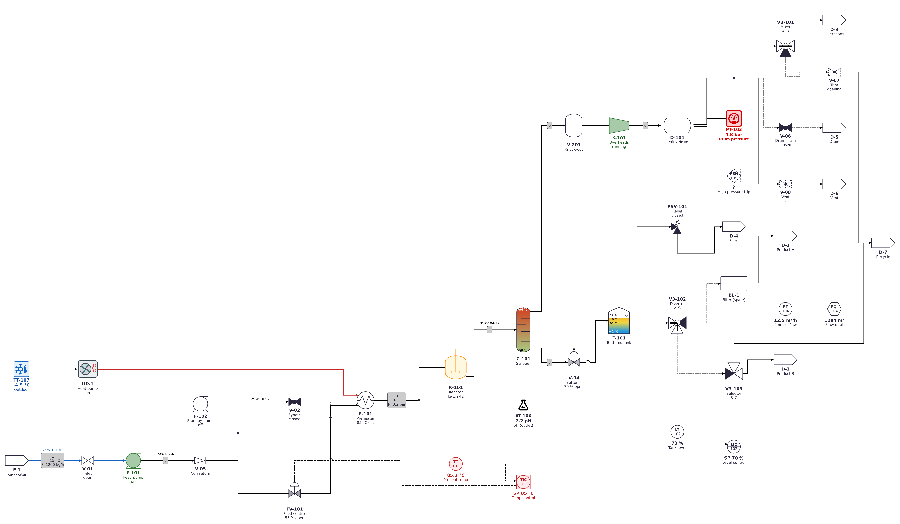
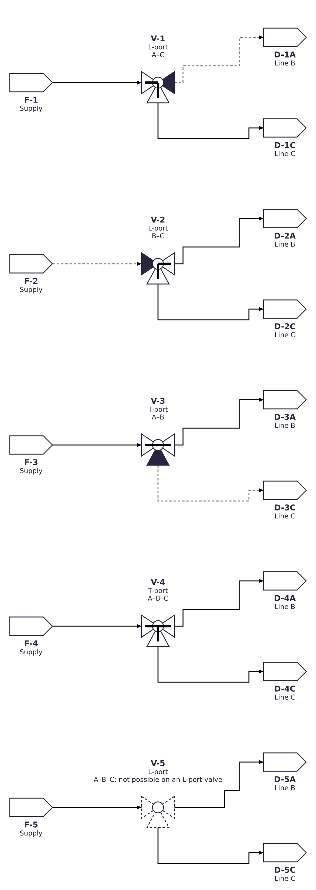
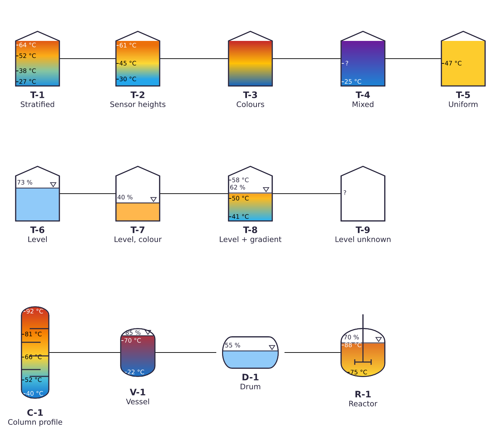

# pid

[-Custom-orange.svg)](https://hacs.xyz)
[](https://github.com/NdS-Research-Facilities/pid/actions/workflows/ci.yml)
[](https://github.com/NdS-Research-Facilities/pid/actions/workflows/marketplace.yml)

> [!IMPORTANT]
> **The Home Assistant card (`custom:pid-card`) draws P&ID diagrams only.** Its diagram text
> must start with `pid` (for example `pid LR`). Flowcharts, sequence diagrams, Gantt charts and
> every other Mermaid diagram type are **not included** in this card and show an error. Use a
> general Mermaid card, such as [ha-mermaid](https://github.com/pajew-ski/ha-mermaid), for those;
> both cards can be used on the same dashboard.

Declarative piping and instrumentation diagrams (P&IDs) for
[Mermaid v13](https://mermaid.js.org/intro/v13-alpha.html), with live values from Home Assistant.

`@nds/diagram-pid` is a Mermaid v13 diagram plugin. It reads `pid` text, lays it out with
Mermaid's own graph engine and draws equipment, valves, ISA-5.1 instruments, process lines and
signal lines. Equipment and instruments carry a state, so a Home Assistant card can fill in live
values through templates.

```
pid LR
  title Buffer tank temperature control
  S-1: feed "Steam"
  TV-101: valve "Steam valve" = 35%
  T-101: tank "Buffer"
  P-101: pump "Circulation" = on
  E-101: exchanger "Heater"
  D-1: product "To process"

  TT-101: instrument "Buffer temp" = 42.5 °C
  TIC-101: instrument dcs "Temp control" = SP 45 °C
  LT-102: instrument "Level" = 73 %

  S-1 --> TV-101 --> E-101
  T-101 -->|1| P-101 -->|2| E-101 -->|3| D-1
  T-101 --- TT-101
  T-101 --- LT-102
  TT-101 -.-> TIC-101 -.-> TV-101
```

## Everything at once

[`examples/all-capabilities.mmd`](examples/all-capabilities.mmd) is a small process plant that
uses every statement, equipment type, valve kind, 3-way bore, instrument location, state style
and line kind. [`examples/all-capabilities.card.yaml`](examples/all-capabilities.card.yaml) is
the same plant as a Home Assistant card: every value from an entity template, plus every card
option (actions, icon packs, image base, theme).



## Syntax

| Statement | Meaning |
| --- | --- |
| `pid [LR\|RL\|TB\|BT]` | Header and flow direction (default `LR`) |
| `title Text` | Diagram title |
| `TAG: type "Name" = state` | Equipment; name and state optional |
| `TAG: instrument [location] "Name" = value` | ISA-5.1 instrument; see below |
| `TAG: valve [kind] "Name" = state` | Valve; see below |
| `TAG = state` | Set a state on its own line (handy for templates) |
| `A --> B -->\|1\| C` | Process line; `\|1\|` is the stream tag |
| `A --- B` | Instrument connection to the process (thin line) |
| `A -.-> B`, `A -.- B` | Signal line (dashed), with or without arrow |
| `stream 1 { T: 25 °C, F: 1200 kg/h }` | Property table shown with stream `1` |
| `%% comment` | Comment |

**Equipment types:** `block tank vessel drum column reactor pump compressor exchanger valve
valve3 feed product instrument tee`.

### Tees and crossings

A `tee` is a junction on a pipe, drawn as a connection dot. Lines split and join at it without
arrowheads, and instruments can tap the pipe there:

```
J-1: tee
P-101 --> J-1 --> FV-102
J-1 --> V-101 --> J-2
J-1 --- PT-101
```

Where two lines cross without a tee, one hops over the other with a small arc.

### Line numbers and line styles

```
pipe 1 4"-P-101-A1              %% by stream tag
pipe J-1>V-101 2"-P-104-A1      %% by its ends
linkStyle 5,6 stroke:#1565c0,stroke-width:2.5px
linkStyle default stroke-width:2px
```

`pipe` writes a line number along the pipe, above its stream tag; the layout keeps room for it.
`linkStyle` works as in Mermaid: lines are numbered from 0 in the order they are written, and
`default` applies to every line. A line the state shows as blocked stays dashed whatever its
style.


### Instruments

The tag is drawn inside the bubble, ISA-5.1 style: function letters over the loop number
(`TIC-101` → `TIC` / `101`). The state is the reading, shown in bold under the bubble.
`unavailable` or `unknown` shows `?` and a dashed bubble.

| Location | Symbol |
| --- | --- |
| `field` (default) | circle |
| `panel` | circle with a line through it |
| `dcs` | circle in a square (shared display / control) |
| `plc` | diamond in a square |
| `computer` | hexagon |

### Valves

- `valve [kind]`: kinds `gate` (default), `globe`, `ball`, `plug`, `butterfly`, `check` and
  `relief` (angle valve with spring; its outlet leaves sideways, like a 3-way valve's `C`; being
  closed in normal service, it never dashes its lines).
  State `open`, `closed`, `opening`, `closing`, a position `0`–`100` (`%` optional), or
  `unavailable`. Closed is drawn solid, open hollow, partly open shaded; moving or unknown is
  dashed. A valve that a signal line drives (`TIC-101 -.-> TV-101`) is drawn as a control valve
  with an actuator, and the signal lands on the actuator.
- `valve3 [L|T]` (3-way): ports `A` (inlet), `B` (straight through) and `C` (branch). Lines
  attach to a port with `V-1.A`. The state lists the connected ports: `AB`, `AC`, `BC`, `ABC`,
  `open` (all) or `closed`. Shut ports are solid, and the process lines on them are dashed.
  - `L`: an L-port ball, joining C to A or to B (`AC`, `BC`) or `closed`.
  - `T`: a T-port ball, joining any two ports or all three (`AB`, `AC`, `BC`, `ABC`); it
    cannot shut off.
  - With `L` or `T` the ball is drawn with its bore pointing at the connected ports. A state
    the bore cannot make (an L-port at `ABC`, a T-port `closed`) is drawn dashed, with the
    reason under the valve, so a wrong sensor value or template stands out.
  - Without `L` or `T`, any combination is accepted and no bore is drawn.

  

### Gradients and levels

Tanks, vessels, drums, columns and reactors can show their contents:

```
gradient T-1 64 °C, 52 °C, 38 °C, 27 °C        %% readings, top to bottom
gradient T-2 61 °C @90%, 45 °C @50%, 30 °C @15% %% at sensor heights (from the bottom)
gradient T-3 #c62828, rgb(255, 193, 7), #1565c0 %% colours instead of readings
gradient-range 20 70                            %% the colour scale: cold … hot (default)
gradient-range T-8 35 60                        %% one vessel's own scale
level T-6 73 %                                  %% liquid level, filled from the bottom
level T-7 40 % #ffb74d                          %% with its own colour
gradient-marks off                              %% hide the readings
```

- A **reading** goes on the colour scale, blue (cold) through yellow to red (hot); stops
  without `@NN%` are spread evenly from top to bottom, and the colours blend between them.
  Readings and colours can be mixed. Stops are separated by commas, so readings use a decimal
  point.
- With a **level**, only the liquid is coloured; the surface gets a line and the P&ID ▽.
- Each reading is written at its height on the inside wall, in black or white for contrast; a
  reading or level Home Assistant does not have (`unavailable`) shows `?`.
- In the card the values come from templates, so the tank follows its sensors:

  ```
  gradient T-1 ${states['sensor.buffer_top']} °C, ${states['sensor.buffer_mid']} °C, ${states['sensor.buffer_bottom']} °C
  level T-1 ${states['sensor.buffer_level']}
  ```



[`examples/gradients.mmd`](examples/gradients.mmd) shows every option;
[`examples/gradients-no-marks.mmd`](examples/gradients-no-marks.mmd) the same without readings.

### Colours, icons and images

Mermaid's own styling statements work on equipment and instruments:

```
classDef alarm fill:#ffcdd2,stroke:#d50000,stroke-width:3px,color:#d50000,font-weight:bold
classDef ok fill:#e8f5e9,stroke:#2e7d32
class PT-103 alarm
class TT-101,TT-102 ok
style P-101 fill:#e8f5e9,stroke:#2e7d32
```

`fill` colours the symbol, `stroke` its outline (and a closed valve's solid fill), `color` the
labels; `stroke-width`, `stroke-dasharray`, `opacity`, `font-weight` and `font-style` apply too.
Mermaid checks every value and drops unsafe ones with a warning. Each class is also written as
an SVG class, `class-<name>`. In the card the class can come from a template, so colours follow
live values:

```
class TT-101 ${if(states['sensor.flow_temp'] > 60, 'alarm', 'ok')}
```

A picture can replace any symbol, keeping its tag, value and name labels:

| Statement | Draws |
| --- | --- |
| `icon PT-103 mdi:gauge [size]` | an [Iconify](https://icon-sets.iconify.design/) icon, default 48 px; tinted with the `stroke` colour |
| `image HP-1 /local/heat-pump.png [W[xH]]` | an image, default 48 px, at most 240 |

In the Home Assistant card, a relative image path loads from `config/www/` (served as `/local/`):
`image HP-1 assets/heat-pump.png` shows `config/www/assets/heat-pump.png`. To try the example,
copy `examples/assets/heat-pump.png` there. Paths starting with `/` and full URLs are used as
written; the card option `image_base` changes the folder.


## Home Assistant card

`custom:pid-card` (in `packages/ha-card`) is a Lovelace card built on Mermaid v13 with the P&ID
plugin included. It re-renders when an entity its templates read changes.

> [!WARNING]
> **P&IDs only.** This card contains Mermaid's engine and the `pid` diagram type, nothing else.
> Diagram text that does not start with `pid` (a `flowchart`, `sequenceDiagram`, `gantt`, …) is
> not drawn; the card shows *"This card draws P&ID diagrams only"* instead. For other Mermaid
> diagrams use a general Mermaid card such as [ha-mermaid](https://github.com/pajew-ski/ha-mermaid).
> Leaving the other diagram types out keeps the card small: about 470 kB (180 kB gzipped)
> instead of 2.2 MB.

```yaml
type: custom:pid-card
title: Buffer tank
content: |
  pid LR
    T-101: tank "Buffer"
    TT-101: instrument "Buffer temp"
    TV-101: valve "Steam valve"
    T-101 --- TT-101
    TT-101 -.-> TV-101

    TT-101 = ${round(states['sensor.buffer_temp'], 1)} °C
    TV-101 = ${attr('valve.steam', 'current_position')}
```

| Option | Default | Description |
| --- | --- | --- |
| `content` | required | Mermaid text with `${...}` templates |
| `title` | — | Card title |
| `theme` | `auto` | `auto` follows the HA theme (light/dark); or `default`, `dark`, `forest`, `neutral`, `base` |
| `entities` | — | Extra entities to watch; those in templates are found automatically |
| `numeric_fallback` | `0` | Number used when a template needs one but the state is not numeric |
| `card_size` | `4` | Card height in the dashboard grid |
| `icon_packs` | `mdi` | Iconify packs by prefix, as URLs of their JSON (`@iconify-json/<pack>/icons.json`) |
| `actions` | — | Tag → what a click does; see below |
| `image_base` | `/local/` | Prefixed to relative image paths in the diagram |
| `auto_more_info` | `true` | Clicking equipment whose state reads one entity opens that entity |

Templates use the same syntax as [ha-mermaid](https://github.com/pajew-ski/ha-mermaid), whose
template engine is included (MIT): `${states['e']}`, `${attr('e', 'a')}`, `${round(x, 1)}`,
`${fixed(x, 2)}`, `${calc(...)}`, `${if(cond, a, b)}`, `${is_state('e', 's')}`,
`${timestamp('e')}` and more. Entity text is masked so it cannot break the diagram syntax; the
P&ID parser decodes it for display.

**Clicking equipment.** Equipment and instruments whose state line reads a single entity
(`TT-101 = ${states['sensor.flow_temp']} °C`) open that entity's more-info dialog when clicked.
`actions` sets or overrides what a click does, with Home Assistant's usual action configs:

```yaml
actions:
  T-101: sensor.buffer_level            # more-info of this entity
  P-101:
    action: toggle
    entity: switch.circulation_pump
    confirmation: true
  E-101:
    action: navigate
    navigation_path: /lovelace/heating
  V-101:
    action: perform-action
    perform_action: valve.close_valve
    target: { entity_id: valve.bypass }
  TT-102: { action: none }
```

Clickable items get a pointer cursor and can be reached with Tab and run with Enter.

**Visual editor.** The card has a form editor for the title, diagram text, theme and size;
`actions` and `icon_packs` are set in the YAML editor.

Icons: `mdi` (Material Design Icons, the set Home Assistant uses) is preset and fetched from
jsDelivr only when a diagram uses an `mdi:` icon. To serve it from Home Assistant instead, copy
`icons.json` from the [`@iconify-json/mdi`](https://www.npmjs.com/package/@iconify-json/mdi)
package to `config/www/mdi.json` and set `icon_packs: { mdi: /local/mdi.json }`. Other packs
(`fa6-solid`, `simple-icons`, …) are added the same way.

### Install

**Manual:** run `pnpm build`, copy `packages/ha-card/dist/pid-card.js` to `config/www/`, and add
`/local/pid-card.js` as a *JavaScript module* under Settings → Dashboards → Resources.

**Marketplace (formerly known as HACS):**

[](https://my.home-assistant.io/redirect/hacs_repository/?owner=NdS-Research-Facilities&repository=pid&category=plugin)

Or in the Marketplace (formerly known as HACS): ⋮ → *Custom repositories* → add `https://github.com/NdS-Research-Facilities/pid`
with type *Dashboard*, then download *P&ID card (Mermaid v13)* and reload the browser. The
Marketplace (formerly known as HACS) installs the `pid-card.js` attached to the latest GitHub
release; CI builds and attaches it when a `v*` tag is pushed.

The bundle is about 470 kB (180 kB gzipped): Mermaid v13's engine with only the `pid` diagram
type and the icons plugin.

## Usage

```js
import mermaid from 'mermaid'; // 13.0.0-alpha.3
import { pid } from '@nds/diagram-pid';

await mermaid.registerExternalDiagrams([pid]);
const { svg } = await mermaid.render('plant', text);
```

## Development

Requires Node 20+ and pnpm.

```sh
pnpm install
pnpm test                           # parser tests + Mermaid renders of examples/ to out/*.svg
node scripts/png.mjs out/*.svg      # PNG previews
```

Mermaid v13 is alpha; the version is pinned exactly to `13.0.0-alpha.3`.

### Known issues

- Mermaid v13 is an alpha; its layout occasionally runs a line close to another item's label.

## References

- [Piping and instrumentation diagram — Wikipedia](https://en.wikipedia.org/wiki/Piping_and_instrumentation_diagram)
- [Process flow diagram — Wikipedia](https://en.wikipedia.org/wiki/Process_flow_diagram)
- [Mermaid v13 alpha](https://mermaid.js.org/intro/v13-alpha.html)

## License

[MIT](LICENSE). `packages/ha-card/src/vendor/template-renderer.ts` comes from
[ha-mermaid](https://github.com/pajew-ski/ha-mermaid) and keeps its own MIT notice.
